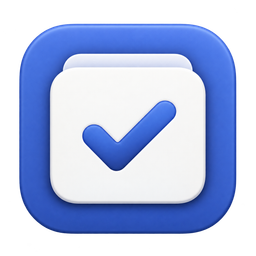
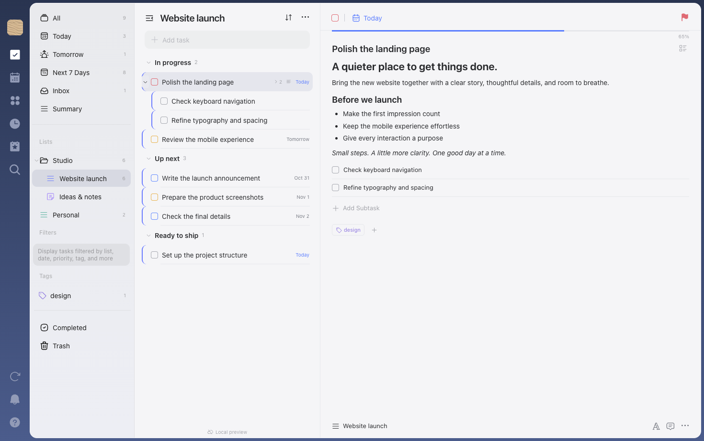
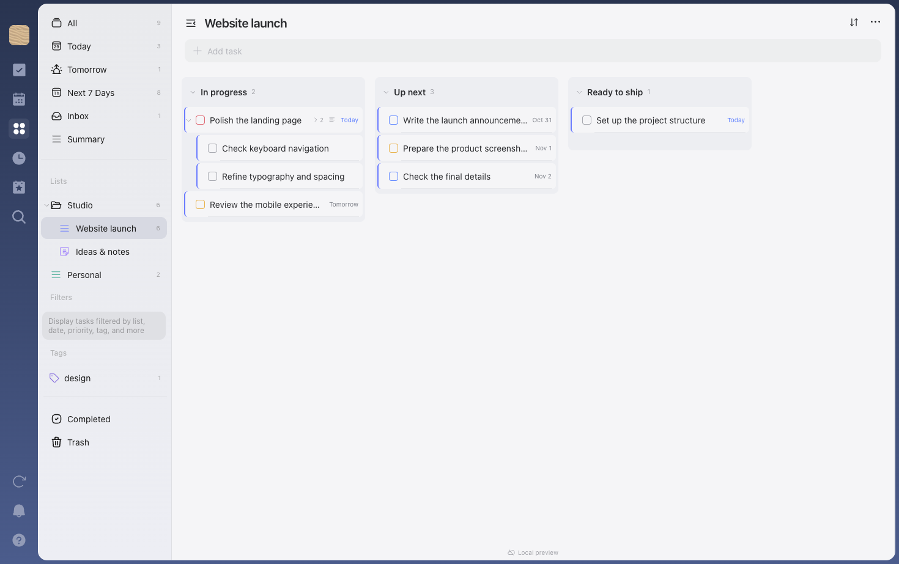
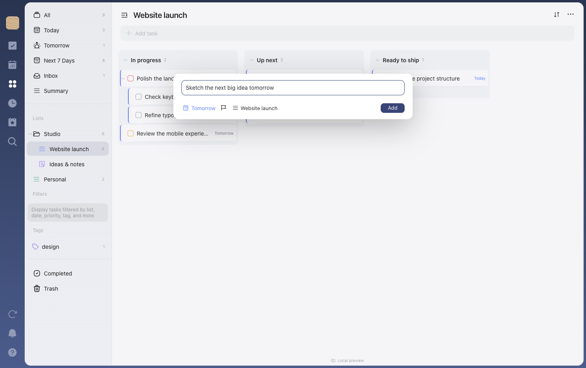

<div align="center">
  

# Tasks

**A little more clarity. One task at a time.**

A local-first task manager for macOS, built with Rust, Tauri and Vue.<br />
Capture an idea, plan your week, and keep the details close.<br />
Your tasks live in SQLite on your Mac. No account required.

<br />


[Take a look](#take-a-look) · [Features](#what-you-can-do) · [Get started](#get-started) · [CLI & MCP](#for-your-terminal-and-your-agents) · [Under the hood](#under-the-hood)

</div>

<br />



<p align="center"><sub>The actual Tasks interface in its local browser preview, with fictional demo data.</sub></p>

## A place for the whole task

A title gets an idea out of your head. Notes, subtasks, dates and reminders turn it into something you can act on. Tasks keeps them together in a familiar three-pane workspace: your lists on the left, your next steps in the middle, and the details on the right.

| 🗂️ Make room for everything | ⌨️ Keep your hands on the keyboard |
| :--- | :--- |
| Nested lists and folders, tags, sections and saved filters. Switch between a simple list, a board and a timeline as your work takes shape. | Quick Add, inline editing, search and a command menu. Capture multiple tasks at once and customize your shortcuts. |
| **💾 Keep your data close** | **🦀 One engine, three ways in** |
| Work offline in a local SQLite database, including attachment contents. Personal cloud sync is optional and requires provider setup. | The desktop app, CLI and MCP server share the same Rust service, validation and database. |

## Take a look

### From the big picture to the next step

Organize a project into sections, move tasks between them, then open any task to work through its notes and subtasks.



### Capture it before you forget it

Quick Add keeps the essentials within reach: a title, a date, a priority and a list. English and French date recognition helps turn a thought into a scheduled task.



All screenshots use the real Vue interface and a separate demonstration database. Native macOS window controls are not shown in the browser preview.

## What you can do

| Area | Available today |
| :--- | :--- |
| **Capture** | Quick Add, inline title editing, multiline task creation, English/French date and recurrence recognition |
| **Organize** | Nested folders and lists, subtasks, tags, saved filters, sections, pinning and reusable templates |
| **Plan** | Today, Tomorrow and Next 7 Days; list, board and timeline views; start/due dates, times, priorities and time zones |
| **Repeat** | Daily, weekly, monthly and yearly rules; selected weekdays, month days, ordinal weekdays and first/last workdays; future-date previews |
| **Keep context** | Rich-text notes, interactive checklists, Markdown paste, attachments, linked tasks and comments |
| **Track progress** | Manual or checklist-based progress, task activity history and restoration of earlier titles and notes |
| **Review** | Search, filtered summaries, saved summary templates and Markdown/plain-text export |
| **Stay in control** | Recoverable Trash, bulk actions, drag-and-drop ordering, configurable shortcuts, light/dark appearance and resizable panes |
| **Use your Mac** | Native reminders with Done, Dismiss and Snooze; printing; optional launch at login and global shortcuts |
| **Automate** | A JSON-capable CLI and a stdio MCP server using the same task engine as the desktop app |

> [!NOTE]
> Tasks is in early development. macOS is the current desktop target. Public builds are ad hoc signed, but not notarized by Apple; macOS may require approval in Privacy & Security on first launch. Google Drive and Dropbox sync adapters are implemented, but real authorization and transfers between Macs still need verification. Shared-list collaboration, assignments and mentions are not available.

## Get started

[**Download Tasks for macOS →**](https://github.com/DwennK/Tasks/releases/latest)

One universal app for **Apple Silicon and Intel**, on macOS 12 or later. Open the DMG and drag Tasks to Applications, or install with Homebrew:

```sh
brew install --cask dwennk/tap/tasks
```

**Settings → Updates** checks GitHub Releases and lets you download, verify and install a new version when you choose. Tasks saves open work before restarting. Automatic checks can be disabled. Homebrew users can also run `brew upgrade --cask --greedy dwennk/tap/tasks`.

Version 0.1.0 needs one manual installation to get the updater. See [releases, updates and signing](docs/releases.md).

### Build from source

You will need **macOS 12+**, **Xcode command line tools**, **stable Rust**, a **Node.js version supported by Vite 8**, and **pnpm 12.15.0**.

```sh
git clone https://github.com/DwennK/Tasks.git
cd Tasks
pnpm install --frozen-lockfile
pnpm desktop
```

Build a local macOS application:

```sh
pnpm bundle --config '{"bundle":{"createUpdaterArtifacts":false}}'
```

The bundle is written to `target/release/bundle/macos/Tasks.app`. The current configuration uses ad hoc signing. The command above skips signed updater archives; public release builds use the separate updater signing key. Apple notarization requires an Apple Developer subscription.

For browser development with a separate database:

```sh
cargo build -p tasks-cli
TASKS_DEV_DB="$PWD/output/dev.sqlite3" pnpm dev
```

The browser bridge is enabled only by the explicit `TASKS_DEV_DB` setting and exists only in the Vite development server. Always use a dedicated development database. `pnpm dev` on its own does not provide task storage.

## For your terminal and your agents

The desktop app is one way to use Tasks. The CLI and MCP server work directly with the same Rust core and local database, without opening a task API port.

```sh
cargo build --release -p tasks-cli -p tasks-mcp

# Capture, find and inspect
target/release/tasks add "Make something worth finishing" --priority 2
target/release/tasks list --view today
target/release/tasks --json list --search "finishing"
```

Connect a compatible MCP client by replacing the executable path below with your own:

```json
{
  "mcpServers": {
    "tasks": {
      "command": "/absolute/path/Tasks/target/release/tasks-mcp",
      "args": []
    }
  }
}
```

By default, these tools access the same database as the desktop app and can change its tasks. Use `--db /absolute/path/demo.sqlite3` for an isolated workspace.

→ [CLI commands, MCP configuration and tool reference](docs/cli-mcp.md)

## Your data

Tasks works locally without a login. The default database lives at:

```text
~/Library/Application Support/com.dwenn.tasks/tasks.sqlite3
```

Attachments are stored inside SQLite alongside their metadata. All three interfaces share this database; `TASKS_DB` overrides its location, and CLI/MCP also accept `--db`.

- **Local task storage.** No Tasks account server or telemetry. Optional automatic update checks contact GitHub; task content is never sent.
- **Optional personal sync.** Connect Google Drive or Dropbox after configuring a provider. OAuth tokens stay in macOS Keychain. See [cloud sync setup and limitations](docs/cloud-sync.md).
- **Recoverable tasks.** Deleting moves a task and its subtasks to Trash. Deleting a list moves its tasks to Inbox.
- **Conflict-aware editing.** Version checks reject stale saves, and the editor preserves the draft for an explicit retry.
- **Backups you control.** Use SQLite's backup API for a consistent copy while the app is running. See the [backup and restore instructions](docs/development.md#data-and-reliability).

Reminders are checked while the desktop app is running. Quitting stops the scheduler; missed reminders are checked on the next launch. macOS notification settings and Focus can affect delivery.

## Under the hood

```text
Vue 3 + TypeScript             CLI                  MCP client
        │                      │                       │
   Tauri 2 IPC             tasks-cli               tasks-mcp
        │                      │                       │
        └──────────────────────┼───────────────────────┘
                               │
                           tasks-core
                    validation · transactions
                    recurrence · history · sync
                               │
                             SQLite
```

| Path | Responsibility |
| :--- | :--- |
| [`src/`](src/) | Vue interface, rich-text editor, styles and native IPC adapter |
| [`src-tauri/`](src-tauri/) | macOS shell, windows, reminders, native integrations and sync providers |
| [`crates/tasks-core/`](crates/tasks-core/) | Shared domain logic, SQLite storage and migrations |
| [`crates/tasks-cli/`](crates/tasks-cli/) | Command-line interface with JSON output |
| [`crates/tasks-mcp/`](crates/tasks-mcp/) | JSON-RPC MCP server over stdio |
| [`tests/`](tests/) | Browser interaction coverage and frontend unit tests |
| [`CONTRACT.md`](CONTRACT.md) | Transport-neutral actions and data contracts |

Built with Tauri 2, Rust, Vue 3, TypeScript, Vite, Tailwind CSS, Tiptap and SQLite. The desktop interface uses the system webview.

## Development

```sh
pnpm check
pnpm build
cargo test --workspace
cargo clippy --workspace --all-targets -- -D warnings

# Browser tests: installed Google Chrome, isolated profile and database
cargo build -p tasks-cli
PLAYWRIGHT_SKIP_BROWSER_DOWNLOAD=1 pnpm test:ui
```

The browser suite uses installed Google Chrome and does not download a browser. Native integrations and real cloud transfers require additional macOS checks.

→ [Development and usage guide](docs/development.md) · [CLI & MCP](docs/cli-mcp.md) · [Cloud sync](docs/cloud-sync.md) · [Releases & updates](docs/releases.md)

Found a bug or have an idea? [Open an issue](https://github.com/DwennK/Tasks/issues). Include the steps to reproduce, your macOS version and what you expected to happen. Use demonstration data when sharing screenshots or logs.

---

<p align="center"><sub>Tasks is an independent project inspired by familiar task-manager workflows. It is not affiliated with TickTick.</sub></p>
